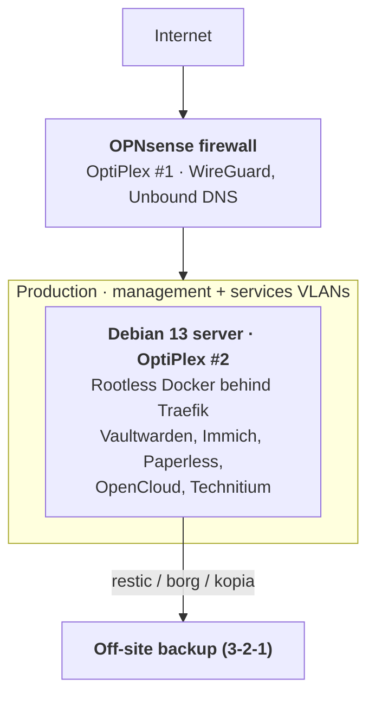

# Production homelab – Project decisions

> Last updated: 2026-10-18 · Author: Mattia Vallortigara
>
> Living document: records the decisions taken and the open points for the new production infrastructure.

## Contents

1. [Goal and principles](#goal-and-principles)
2. [Architecture](#architecture)
3. [Hardware](#hardware)
4. [Firewall](#firewall)
5. [Server](#server)
6. [Services](#services)
7. [Network, DNS and remote access](#network-dns-and-remote-access)
8. [Backup and restore](#backup-and-restore)
9. [Ansible and Semaphore](#ansible-and-semaphore)
10. [Security](#security)
11. [Vulnerability notifications](#vulnerability-notifications)
12. [Open points](#open-points)

## Goal and principles

Move production data and services to a simple infrastructure, separate from the lab and reliably restorable.

The current cluster (3 Proxmox nodes with no HA or shared storage, Talos K8s, OPNsense HA, Docker VMs) stays as the lab environment. Production follows three principles:

- **Simplicity first**: fewer components, well-documented and familiar technologies.
- **Restorability**: configuration rebuilt from Ansible, data restored from tested backups.
- **Isolation**: a failure or an experiment in the lab must never affect production.

## Architecture

The production firewall sits in front of everything; production lives in its own zones, and the server's data goes to an off-site backup.

## Hardware

Two Dell OptiPlex 3050 Micro with Libreboot as firmware: one for the firewall, one for the server.

| Machine | Role | Constraints and notes |
| --- | --- | --- |
| OptiPlex 3050 Micro #1 | OPNsense firewall | A single Ethernet port: router-on-a-stick with VLANs on a managed switch |
| OptiPlex 3050 Micro #2 | Debian server | A single disk for OS, containers and data: backup is the only protection against a disk failure |

- Managed switch with 802.1Q: trunk to the firewall and the server.
- A UPS with NUT is recommended for clean shutdowns and to protect the databases.

## Firewall

OPNsense on a single node, in front of the whole home network. Alternatives considered and rejected: pfSense CE, OpenWrt x86, VyOS (none clearly better for this case).

- The current HA is dropped: the firewall is a single point of failure, accepted for a home environment.
- Mitigations: versioned backup of the XML configuration and a USB stick with the installer ready.
- Provides WireGuard for remote access and Unbound as DNS resolver.

## Server

Debian 13 with rootless Docker. Alpine was rejected: with OpenRC, rootless has to be built by hand, while Debian ships systemd, `unattended-upgrades` and `reboot-required` out of the box.

systemd's attack surface was assessed and considered a minor risk: its components are not network-exposed, the unneeded ones (resolved, networkd) stay disabled, and unit sandboxing is an advantage.

**Container runtime**: rootless Docker, considered more polished than Podman and compatible with the official compose files. It runs under a dedicated service user, with no login and separate from `admin_user`, so access to the socket is not tied to the administrative account.

**Image updates**: Tugtainer rejected, because with exact pinned versions it does not detect new releases. Choice: self-hosted Renovate on the Ansible repository, which reads the pinned versions and opens a PR with the changelog for each new release; after merging, the update is applied with the `update-containers` tag. It runs as a scheduled job on the production server using the open source `renovate/renovate` image (AGPL-3.0), not the Mend CE/EE editions, which are closed source.

Major database upgrades (Postgres for Immich and Paperless) go in a separate Renovate group, handled manually: they require dump and restore, and Immich uses a specific Postgres image with vector extensions.

Rootless considerations:

- Ports below 1024 (53, 80, 443): `net.ipv4.ip_unprivileged_port_start=53` via sysctl.
- The real source IP is required for Traefik and Technitium: rootlesskit port driver `slirp4netns` (or `pasta` with the implicit port driver) instead of the default `builtin`, which does not preserve it.
- No hardware transcoding for Immich: `/dev/dri` is not exposed.

Disk health and free space, critical with a single disk:

- `smartmontools` (smartd) with alerts on SMART values, to get a few days' warning before a failure.
- Free space alert: Immich and OpenCloud grow quickly, and a full disk can corrupt the databases.

## Services

Seven services on the server, behind Traefik. None is publicly exposed. Image versions always pinned in the repository, never `:latest`.

| Service | Domain | Notes |
| --- | --- | --- |
| Traefik | traefik.example.com | Reverse proxy, Let's Encrypt with Cloudflare DNS challenge |
| Vaultwarden | vault.example.com | Critical: reachable only via WireGuard |
| Immich | photo.example.com | Frequent breaking changes: update after reading the changelogs |
| OpenCloud | cloud.example.com | File sync only; lighter than Nextcloud (no PHP, no external database) |
| Paperless | document.example.com | Postgres database to include in the dumps |
| Technitium | dns.example.com | Forwards to Unbound: with egress blocked it cannot resolve recursively |
| Uptime Kuma | health.example.com | Outside the server it monitors, preferably on-prem (options to evaluate) |

## Network, DNS and remote access

No service is exposed to the Internet: remote access goes only through WireGuard on OPNsense. The server cannot browse: it can only reach the destinations allowed on OPNsense.

- Separate VLANs on the managed switch: server management (SSH, Ansible, Semaphore), container services, lab, home clients.
- The server has a single NIC on an 802.1Q trunk, with one IP per VLAN. sshd listens only on the management IP; Traefik and Technitium publish their ports only on the services IP.
- The server needs source-based routing (`ip rule`): replies from the management IP must leave through the management VLAN, otherwise OPNsense drops the asymmetric traffic.
- The lab reaches neither management nor production services, except for explicit exceptions.
- DNS: Unbound on OPNsense as the main resolver; Technitium forwards to Unbound. NTP also goes through OPNsense.
- Uptime Kuma: outside the server, preferring on-prem solutions (options to evaluate).

Outbound destinations to allow (FQDN aliases on OPNsense):

| Destination | Purpose |
| --- | --- |
| deb.debian.org, security.debian.org | System updates |
| registry-1.docker.io, auth.docker.io, production.cloudflare.docker.com | Docker Hub image pulls |
| ghcr.io, pkg-containers.githubusercontent.com | GitHub image pulls (e.g. Immich) |
| database.clamav.net | ClamAV signatures (freshclam) |
| api.telegram.org | Telegram notifications |
| huggingface.co | Immich ML model downloads |
| api.cloudflare.com, acme-v02.api.letsencrypt.org | Let's Encrypt certificates via Cloudflare DNS challenge |
| Off-site backup destination | To be defined with the backup tool |

FQDN aliases are resolved periodically, but services behind CDNs change IPs often: occasional pull or download errors are to be expected. With Renovate on the server, the repository's git forge and github.com / api.github.com (for changelogs) are also needed. The list must be checked against the firewall logs during the first deployment.

## Backup and restore

Backup is the project's priority: Ansible rebuilds the configuration, but only the backup brings the data back. With a single disk in the server, it is also the only protection against a hardware failure.

- 3-2-1 scheme: a local copy plus an off-site one (e.g. Backblaze B2, Hetzner Storage Box or a remote external disk).
- Tool: restic, borg or kopia (to be chosen).
- Consistent dumps of the Postgres databases (Immich, Paperless) before each backup.
- Versioned backup of the OPNsense configuration.
- Periodic automated restore test with the `backup-verify` tag in Semaphore.

## Ansible and Semaphore

The current playbook (designed for Alpine) is restructured into roles for Debian, keeping the parts that already work: anti-lockout asserts, validated sshd drop-in, secrets in Ansible Vault.

Planned roles: `base`, `hardening`, `firewall-host` (nftables), `containers`, one role per application, `backup`.

| Tag | What it does | Run in Semaphore |
| --- | --- | --- |
| `update-os` | Package updates and reboot only when required | Scheduled |
| `update-containers` | Pull and restart of the versions pinned in the repo | Manual, after reading the changelogs |
| `backup-verify` | Test restore into a temporary directory | Scheduled |

- New image versions proposed by Renovate as PRs on the repository; the update is applied with the `update-containers` tag.
- ClamAV kept: current scan script and Telegram notifications reused, with the Debian adaptations listed below.

ClamAV adaptations:

- Debian packages and services: `clamav`, `clamav-daemon`, `clamav-freshclam` (services `clamav-daemon` and `clamav-freshclam`); `clamav-libunrar` does not exist on Debian.
- Scan paths: exclude image layers (`~/.local/share/docker` of the service user) and scan user data in the volumes (OpenCloud uploads, Paperless consume, Immich library).
- Egress: freshclam and Telegram must be among the allowed destinations.
- RAM: clamd uses about 1–1.5 GB.

## Security

The main risk is the exposed web apps, not the operating system: defences focus there.

1. No public services: access only via WireGuard.
2. Rootless containers with pinned versions, updated regularly.
3. Automatic system security updates (`unattended-upgrades`).
4. Key-only SSH, `AllowUsers` limited to the admin user, root disabled.
5. Host firewall with nftables in addition to OPNsense; outbound Internet blocked except for allowed destinations; management and services on separate VLANs.
6. Cloudflare token limited to *Zone → DNS → Edit* on the single zone in use. Secrets always encrypted with Ansible Vault; pre-commit hook that rejects an unencrypted `vault.yml`.

## Vulnerability notifications

Every technology in use must have a source of security alerts that reaches Telegram or email, without relying on cloud services where possible.

| Layer | Tool | How the alert arrives |
| --- | --- | --- |
| Debian packages | debsecan + debian-security-announce list | Scheduled report from Semaphore, email for DSAs |
| Container images | Trivy (or Grype) on the images in use | Weekly scan from Semaphore, summary on Telegram |
| Applications (Traefik, Vaultwarden, Immich, OpenCloud, Paperless, Technitium) | Project GitHub repositories: *Watch → Custom → Releases*, plus the Security advisories page; Renovate PRs flag every new release | GitHub email or RSS feed |
| OPNsense | Built-in firmware security audit + release announcements | Scheduled check, mailing list |
| ClamAV, Docker, Libreboot | GitHub repositories (Cisco-Talos/clamav, moby/moby) and Libreboot announcements | Email |

Trivy runs outside the production server: it downloads its database from the Internet, which keeps the server's egress minimal.

## Open points

Decided on 18 October 2026: rootless Docker, VLANs on a managed switch, OpenCloud, a single disk, no public services, ClamAV kept, Let's Encrypt with Cloudflare DNS challenge, real source IP for the services, no hardware transcoding, Renovate for image updates. Tugtainer and OpenCVE rejected.

- [ ] Backup tool (restic, borg, kopia) and off-site destination.
- [ ] Where to run Uptime Kuma, preferring on-prem solutions.
- [ ] Where to run Trivy (Semaphore host or lab).
- [ ] Application vulnerabilities: GitHub email notifications or `releases.atom` feeds in a self-hosted RSS reader (OpenCVE rejected because of its BSL license).
- [ ] Final list of outbound destinations, after the first deployment.
- [ ] Offline copy of the emergency secrets (backup repository password, Ansible Vault password, Cloudflare token) and periodic encrypted Vaultwarden export: where and how to store them outside the infrastructure.
- [ ] Full disaster recovery drill (Debian from scratch in a lab VM, playbook, restore, service checks) with a runbook and measured times: frequency and procedure.
- [ ] Alerts for jobs that do not run (backup, ClamAV scan, Renovate) through Uptime Kuma push monitors, plus certificate expiry monitors.
- [ ] Protecting Semaphore, which has root access to production: location (management VLAN), updates, access; ability to run the playbook from the laptop, and a mirror of the git repository if it is hosted in the lab.
