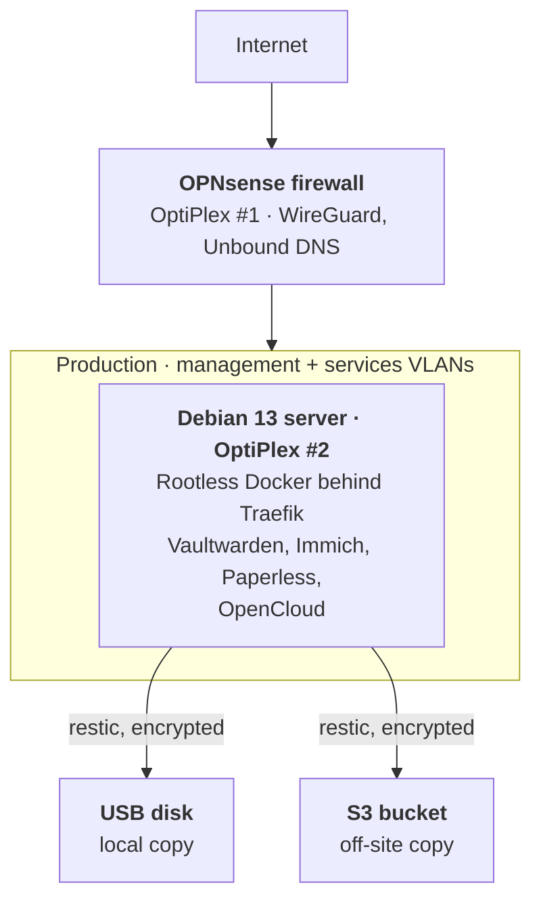

# Production homelab – Project decisions

> Last updated: 2026-11-10 · Author: Mattia Vallortigara
>
> Living document: records the decisions taken and the open points for the new production infrastructure.

## Contents

1. [Goal and principles](#goal-and-principles)
2. [Architecture](#architecture)
3. [Hardware](#hardware)
4. [Firewall](#firewall)
5. [Server](#server)
6. [Services](#services)
7. [Network, DNS and remote access](#network-dns-and-remote-access)
8. [Backup and restore](#backup-and-restore)
9. [Ansible and Semaphore](#ansible-and-semaphore)
10. [Security](#security)
11. [Vulnerability notifications](#vulnerability-notifications)
12. [Open points](#open-points)

## Goal and principles

Move production data and services to a simple infrastructure, separate from the lab and reliably restorable.

The current cluster (3 Proxmox nodes with no HA or shared storage, Talos K8s, OPNsense HA, Docker VMs) stays as the lab environment. Production follows three principles:

- **Simplicity first**: fewer components, well-documented and familiar technologies.
- **Restorability**: configuration rebuilt from Ansible, data restored from tested backups.
- **Isolation**: a failure or an experiment in the lab must never affect production.

## Architecture

The production firewall sits in front of everything; production lives in its own zones, and the server's data goes to an off-site backup.

## Hardware

Two Dell OptiPlex 3050 Micro with Libreboot as firmware: one for the firewall, one for the server.

| Machine | Role | Constraints and notes |
| --- | --- | --- |
| OptiPlex 3050 Micro #1 | OPNsense firewall | A single Ethernet port: router-on-a-stick with VLANs on a managed switch |
| OptiPlex 3050 Micro #2 | Debian server | A single disk for OS, containers and data, encrypted with LUKS: backup is the only protection against a disk failure, and every boot waits for the passphrase at the console |

- Managed switch with 802.1Q: trunk to the firewall and the server.
- A UPS with NUT is recommended for clean shutdowns and to protect the databases. With the encrypted disk it matters more: after a power cut the server stays at the passphrase prompt, and everything is down until someone types it.

## Firewall

OPNsense on a single node, in front of the whole home network. Alternatives considered and rejected: pfSense CE, OpenWrt x86, VyOS (none clearly better for this case).

- The current HA is dropped: the firewall is a single point of failure, accepted for a home environment.
- Mitigations: versioned backup of the XML configuration and a USB stick with the installer ready.
- Provides WireGuard for remote access and Unbound as DNS resolver.

## Server

Debian 13 with rootless Docker. Alpine was rejected: with OpenRC, rootless has to be built by hand, while Debian ships systemd, `unattended-upgrades` and `needrestart` (which tells when a newer kernel waits for a reboot) out of the box.

systemd's attack surface was assessed and considered a minor risk: its components are not network-exposed, the unneeded ones (resolved, networkd) stay disabled, and unit sandboxing is an advantage.

**Container runtime**: rootless Docker, considered more polished than Podman and compatible with the official compose files. It runs under a dedicated service user, with no login and separate from `admin_user`, so access to the socket is not tied to the administrative account.

**Container layout**: one directory per service, with its compose file, data and database dumps. Infrastructure (Traefik) goes under `/srv/docker/system/<name>`, applications (Vaultwarden, Immich, OpenCloud, Paperless) under `/srv/docker/app/<name>`.

**Image updates**: Tugtainer rejected, because with exact pinned versions it does not detect new releases. Choice: self-hosted Renovate on the Ansible repository, which reads the pinned versions and opens a PR with the changelog for each new release; after merging, the update is applied with the `update-containers` tag. It runs every Saturday morning from a GitHub Actions workflow in the repository, using the open source `renovate/renovate` image (AGPL-3.0) — not the Mend CE/EE editions, which are closed source, nor the hosted Mend app — with the job's own short-lived `GITHUB_TOKEN`; a Telegram message lists the new PRs. Nothing is merged automatically.

Major database upgrades (Postgres for Immich and Paperless) are not proposed by Renovate and are handled manually: they require dump and restore, and Immich uses a specific Postgres image with vector extensions.

Rootless considerations:

- Ports below 1024 (80, 443, Traefik only): `net.ipv4.ip_unprivileged_port_start=80` via sysctl.
- The real source IP is required for Traefik, which logs it and passes it to the services (`X-Real-Ip`, e.g. Vaultwarden's failed logins): rootlesskit port driver `slirp4netns` (or `pasta` with the implicit port driver) instead of the default `builtin`, which does not preserve it.
- No hardware transcoding for Immich: `/dev/dri` is not exposed.

**Disk encryption and reboots**: the disk is encrypted with LUKS and the passphrase is typed at the console at every boot (no remote unlock for now). Nothing reboots the server by itself: unattended-upgrades and the `update-os` job report on Telegram when a reboot is needed, and the administrator reboots when they can be at the machine. Network changes, which reboot, are done at the console.

Disk health and free space, critical with a single disk:

- `smartmontools` (smartd) with alerts on SMART values, to get a few days' warning before a failure.
- Free space alert: Immich and OpenCloud grow quickly, and a full disk can corrupt the databases.

## Services

Five services on the server — Traefik and the four applications behind it — plus Uptime Kuma outside it. None is publicly exposed. Image versions always pinned in the repository, never `:latest`.

| Service | Domain | Notes |
| --- | --- | --- |
| Traefik | proxy.greyroom.net | Reverse proxy; one Let's Encrypt wildcard certificate for `*.greyroom.net` (Cloudflare DNS challenge); routes from files written by Ansible, no Docker socket |
| Vaultwarden | vault.greyroom.net | Critical: reachable only via WireGuard. SQLite; on its internal network only, so no Internet access (no favicons, no e-mail); sign-ups off, admin page disabled |
| Immich | photo.greyroom.net | Frequent breaking changes: update after reading the changelogs. No machine learning (RAM): no faces or smart search. No Internet access; the whole library is backed up, thumbnails included |
| OpenCloud | cloud.greyroom.net | File sync only, replaces Nextcloud (files migrated; no calendars or contacts); lighter than Nextcloud (no PHP, no external database). Production release line, PosixFS storage, built-in users; no Internet access; no Collabora; stopped during the nightly backup |
| Paperless | document.greyroom.net | Postgres database to include in the dumps |
| Uptime Kuma | health.greyroom.net | Outside the server it monitors, preferably on-prem (options to evaluate) |

## Network, DNS and remote access

No service is exposed to the Internet: remote access goes only through WireGuard on OPNsense. The server cannot browse: it can only reach the destinations allowed on OPNsense.

- Separate VLANs on the managed switch: server management (SSH, Ansible, Semaphore), container services, lab, home clients.
- The server has a single NIC on an 802.1Q trunk, with one IP per VLAN. sshd listens only on the management IP; Traefik publishes its ports only on the services IP.
- The server needs source-based routing (`ip rule`): replies from the management IP must leave through the management VLAN, otherwise OPNsense drops the asymmetric traffic.
- The lab reaches neither management nor production services, except for explicit exceptions.
- DNS: Unbound on OPNsense is the only resolver; the internal names (`<service>.greyroom.net` → services IP) are host overrides in Unbound. NTP also goes through OPNsense: the server's VLANs need rules for DNS (53) and NTP (123) to the firewall itself.
- Uptime Kuma: outside the server, preferring on-prem solutions (options to evaluate).

Outbound destinations to allow (an OPNsense alias of type Host(s), one name per line):

| Destination | Purpose |
| --- | --- |
| deb.debian.org, security.debian.org | System updates |
| download.docker.com | Docker packages |
| registry-1.docker.io, auth.docker.io, production.cloudflare.docker.com, production.cloudfront.docker.com | Docker Hub image pulls (layers come from either CDN) |
| ghcr.io, pkg-containers.githubusercontent.com | GitHub image pulls (e.g. Immich) |
| database.clamav.net | ClamAV signatures (freshclam) |
| api.telegram.org | Telegram notifications |
| api.cloudflare.com, acme-v02.api.letsencrypt.org | Let's Encrypt certificates via Cloudflare DNS challenge |
| S3 endpoint of the backup bucket | Off-site backup (restic) |

Host aliases are resolved periodically, but services behind CDNs change IPs often: CloudFront every minute. The alias resolve interval is set to 30 seconds (*Firewall → Settings → Advanced*); without it, pulls fail whenever the server gets an address the alias does not have yet. The list was checked against the firewall logs during the first deployment (November 2026).

## Backup and restore

Backup is the project's priority: Ansible rebuilds the configuration, but only the backup brings the data back. With a single disk in the server, it is also the only protection against a hardware failure.

- 3-2-1 scheme: the data on the server, a local copy on an external USB disk and an off-site copy in an S3 bucket.
- Tool: **restic** (Debian package, encryption built in, S3 and local disk with no extra components). Both copies are encrypted with the same password, kept on the emergency sheet.
- The USB disk is mounted only while the backup runs; the bucket has object lock or versioning, because the server's key can delete objects.
- Telegram message at every run, with the result of each copy.
- Consistent dumps of the databases before each backup: SQLite's online backup for Vaultwarden, `pg_dumpall` for Immich (and Paperless); the live database directories are left out. OpenCloud has no database: it is stopped during the backup and started again after it, as its backup guide asks.
- Versioned backup of the OPNsense configuration.
- Periodic automated restore test with a `backup-verify` tag in Semaphore: planned, not built yet (ansible-prod-srv issue #13). Until then, a restore test by hand every three months.

## Ansible and Semaphore

The earlier playbook (designed for Alpine) was restructured into roles for Debian, keeping the parts that already worked: anti-lockout asserts, validated sshd drop-in, secrets in Ansible Vault.

Roles in place: `base`, `hardening`, `network` (VLANs and source routing), `firewall_host` (nftables), `docker_rootless`, `notify` (Telegram), `clamav`, `monitoring` (SMART, disk space), `integrity`, `yara`, `backup` (restic), `update_os`, `traefik`, `vaultwarden`, `immich`, `opencloud`, plus Renovate in GitHub Actions. Still to come: Paperless.

| Tag | What it does | Run in Semaphore |
| --- | --- | --- |
| `update-os` | Package updates; reports on Telegram when a reboot is needed (no automatic reboot: encrypted disk) | Scheduled |
| `update-containers` | Pull and restart of the versions pinned in the repo | Manual, after reading the changelogs |
| `backup-verify` | Test restore into a temporary directory (planned) | Scheduled |

- New image versions proposed by Renovate as PRs on the repository; the update is applied with the `update-containers` tag.
- ClamAV kept: current scan script and Telegram notifications reused, with the Debian adaptations listed below.

ClamAV adaptations:

- Debian packages and services: `clamav`, `clamav-daemon`, `clamav-freshclam` (services `clamav-daemon` and `clamav-freshclam`); `clamav-libunrar` does not exist on Debian.
- Scan paths: exclude image layers (`~/.local/share/docker` of the service user) and scan user data in the volumes (OpenCloud uploads, Paperless consume, Immich library).
- Egress: freshclam and Telegram must be among the allowed destinations.
- RAM: clamd uses about 1–1.5 GB.

## Security

The main risk is the exposed web apps, not the operating system: defences focus there.

1. No public services: access only via WireGuard.
2. Rootless containers with pinned versions, updated regularly.
3. Automatic system security updates (`unattended-upgrades`).
4. Key-only SSH, `AllowUsers` limited to the admin user, root disabled.
5. Host firewall with nftables in addition to OPNsense; outbound Internet blocked except for allowed destinations; management and services on separate VLANs.
6. Cloudflare token limited to the single zone in use, with *Zone → Zone → Read* and *Zone → DNS → Edit* (both needed by Traefik's ACME client). Secrets always encrypted with Ansible Vault; pre-commit hook that rejects an unencrypted `vault.yml`.
7. Detection on the server: a check every 15 minutes for the traces of OpenSSH backdoors such as Ebury (NTP off, sshd logging lowered, unpackaged or setuid libraries, preloaded libraries) and a nightly YARA scan, both reporting to Telegram.

**Disk encryption and container escapes.** The server's disk is encrypted with LUKS, which protects a stolen disk or a server that is off, not a running system: once Debian is unlocked, files are readable by whoever has the permissions. All containers run as the same rootless service user, so an escape from any of them reads the data of all of them, Vaultwarden's database included (becoming root would take a second, kernel exploit). For Vaultwarden this is acceptable because the vault items are encrypted on the client with the master password, which the server never sees: the attacker would have to guess it offline. In clear are only the metadata (e-mails, dates, number of items) and the two-factor TOTP secrets. The larger risk is that the attacker controls the Docker daemon and can tamper with Vaultwarden to serve a web vault that captures the master password. Hence: a long master password with Argon2id, and the apps or the browser extension (not the web vault) for daily use. A separate service user for Vaultwarden would remove the shared exposure; not adopted for now, to keep a single Docker daemon.

## Vulnerability notifications

Every technology in use must have a source of security alerts that reaches Telegram or email, without relying on cloud services where possible, and without adding infrastructure: each extra tool is one more thing for a single person to maintain.

| Layer | Tool | How the alert arrives |
| --- | --- | --- |
| Debian packages | `unattended-upgrades` (security updates applied daily) + debian-security-announce list | Telegram after every unattended-upgrades run (installed, nothing, errors, reboot needed); email for DSAs |
| Applications and their images (Traefik, Vaultwarden, Immich, OpenCloud, Paperless) | Project GitHub repositories: *Watch → Custom → Releases* and *Security alerts*; Renovate PRs flag every new release | GitHub email; Renovate's Saturday summary on Telegram |
| OPNsense | Built-in firmware security audit + release announcements | Scheduled check, mailing list |
| ClamAV, Docker, Libreboot | GitHub repositories (Cisco-Talos/clamav, moby/moby) and Libreboot announcements | Email |

Dropped for simplicity on 24 October 2026: Trivy/Grype image scans, debsecan reports and a self-hosted RSS reader. Renovate, GitHub release and advisory emails, and `unattended-upgrades` cover the same ground with no extra components. Remote logging and a full file-integrity database (AIDE) are not planned for now; the server runs targeted integrity checks and a nightly YARA scan instead (see ansible-prod-srv).

## Open points

Decided on 18 October 2026: rootless Docker, VLANs on a managed switch, OpenCloud, a single disk, no public services, ClamAV kept, Let's Encrypt with Cloudflare DNS challenge, real source IP for the services, no hardware transcoding, Renovate for image updates. Tugtainer and OpenCVE rejected. Decided on 24 October 2026: vulnerability alerts through GitHub email, Renovate and Debian's channels only (no Trivy, debsecan or RSS reader); no remote logging or AIDE for now. Backup: restic to a USB disk and an S3 bucket, both encrypted, with Telegram reports. Container layout: `/srv/docker/system` for infrastructure, `/srv/docker/app` for applications. Traefik: domain greyroom.net with a wildcard certificate (internal names stay out of the Certificate Transparency logs), file provider only, no access to the Docker socket. Decided on 8 November 2026: no Technitium, DNS stays on Unbound alone (one component less; host overrides cover the internal names); Vaultwarden with SQLite, only on its internal network (no Internet access), no admin page. Immich without the machine learning container (1.5–3 GB of RAM on an 8 GB server that also runs ClamAV; it can be added later with Hugging Face on the egress list), no Internet access for any of its containers, the whole library in the backup including thumbnails and transcoded videos (faster restore), and a 10-minute read timeout in Traefik for long video uploads. Decided on 10 November 2026: Renovate runs in GitHub Actions instead of on the production server — no write token for the repository on the server, no egress to GitHub, no extra RAM, and GitHub reports failed runs (which also removes Renovate from the job alerts to build). Decided on 10 November 2026: the disk is encrypted with LUKS, so nothing reboots the server by itself; unattended-upgrades reports every run on Telegram, and update-os reports a needed reboot instead of rebooting. Decided on 10 November 2026: OpenCloud on the production release line (rolling is meant for evaluation), PosixFS storage, built-in user directory; no Collabora for now (it parses untrusted documents on the server and needs more privileges; documents open in the desktop and mobile apps); no Internet access, with Traefik answering to `cloud.greyroom.net` on OpenCloud's own network for its login checks; stopped during the nightly backup. Nextcloud's files are migrated as plain files (no shares, versions, calendars or contacts), then Nextcloud is retired.

- [ ] Object lock (bucket lock rule) or versioning on the Cloudflare R2 bucket used for the off-site copy: to confirm. The provider itself is decided (R2, in the inventory).
- [ ] Where to run Uptime Kuma, preferring on-prem solutions.
- [ ] Offline copy of the emergency secrets (backup repository password, Ansible Vault password, Cloudflare token; the S3 key can be regenerated at the provider) and periodic encrypted Vaultwarden export: where and how to store them outside the infrastructure.
- [ ] Full disaster recovery drill (Debian from scratch in a lab VM, playbook, restore, service checks) with a runbook and measured times: frequency and procedure.
- [ ] Alerts for jobs that do not run (backup, ClamAV scan) through Uptime Kuma push monitors, plus certificate expiry monitors.
- [ ] Protecting Semaphore, which has root access to production: location (management VLAN), updates, access; ability to run the playbook from the laptop, and a mirror of the git repository if it is hosted in the lab.
